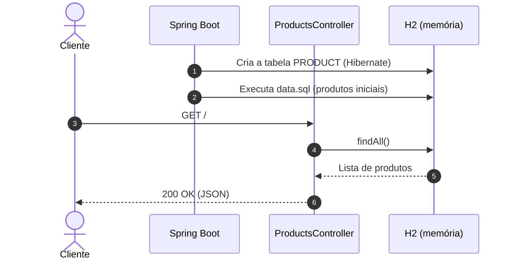

# 🛍️ Products API — Lista de Produtos


> Uma API REST mínima que devolve, em JSON, uma lista de produtos com loja, preço, categoria, link e imagem.

A **Products API** é uma API simples desenvolvida em **Java 11** e **Spring Boot**, pensada para estudo e demonstração dos conceitos básicos de APIs REST. Ao iniciar, ela carrega um catálogo de produtos num banco **H2 em memória** e expõe esses dados num único endpoint. Foi preparada para deploy no **Heroku**.



---

## ✨ O Problema
Quem está começando com front-end ou com APIs precisa de:
- **Dados realistas para consumir**, sem montar um backend completo.
- **Um exemplo enxuto** de como um projeto Spring Boot é organizado.

---

## 🚀 A Solução
- **Endpoint único** que devolve a lista completa de produtos em JSON.
- **Banco em memória** com dados de exemplo carregados automaticamente: nada para instalar além do JDK.
- **Console H2** habilitado para inspecionar os dados pelo navegador.

---

## 🎯 Diferenciais
- **Zero configuração**: Sem banco externo, sem variáveis de ambiente obrigatórias.
- **Pronta para Heroku**: `system.properties` define a versão do Java usada no deploy.
- **Código mínimo**: Controller, entidade e repositório — fácil de ler e estender.

---

## 🛠️ Stack Tecnológica

| Camada | Tecnologia |
|---|---|
| **Linguagem** | Java 11 |
| **Framework** | Spring Boot 2.5.6 (Web, Data JPA, DevTools) |
| **Banco de Dados** | H2 (em memória) |
| **Deploy** | Heroku |
| **Build** | Maven (wrapper incluso) |

---

## 🏛️ Arquitetura

```
Controller   ← Endpoint REST (ProductsController)
   ↓
Repository   ← Interface Spring Data JPA
   ↓
Model        ← Entidade JPA Product
```

### Entidade Principal
- **`Product`**: `id`, `nome`, `loja`, `preco`, `categoria`, `url` (link da oferta) e `img` (URL da imagem).

---

## 📁 Estrutura do Projeto

```text
products-api/
├── pom.xml
├── system.properties            # Versão do Java para o Heroku
├── mvnw / mvnw.cmd
└── src/main/
    ├── java/br/com/API/
    │   ├── Controller/          # Endpoint REST
    │   ├── Model/               # Entidade JPA
    │   └── Repository/          # Repositório Spring Data
    └── resources/
        ├── application.properties
        └── data.sql             # Produtos carregados na inicialização
```

---

## ⚡ Quick Start

### Pré-requisitos
- [JDK 11](https://adoptium.net/) ou superior instalado

### 1. Clonar o repositório
```bash
git clone https://github.com/matheusnascimentods/products-api.git
cd products-api
```

### 2. Executar a Aplicação
```bash
./mvnw spring-boot:run
```

A API estará disponível em: **`http://localhost:8080`**

O console do H2 fica em **`http://localhost:8080/h2-console`** (JDBC URL `jdbc:h2:mem:products`, usuário `sa`, sem senha).

Também é possível baixar o JAR pronto na release do repositório e rodar com `java -jar api-product-list.jar`.

---

## 💻 Comandos Úteis de Desenvolvimento

```bash
# Compilar o projeto
./mvnw clean compile

# Rodar os testes
./mvnw test

# Empacotar o JAR e executá-lo
./mvnw clean package
java -jar target/API-Product-List-0.0.1-SNAPSHOT.jar
```

---

## 🔌 API Reference

| Método | Rota | Descrição |
| :--- | :--- | :--- |
| `GET` | `/` | Lista todos os produtos |

Exemplo de resposta:
```json
[
  {
    "id": 1,
    "nome": "Mouse Gamer Logitech G203 LIGHTSYNC RGB",
    "loja": "Amazon",
    "preco": 119.9,
    "categoria": "Computador",
    "url": "https://www.amazon.com.br/...",
    "img": "https://m.media-amazon.com/..."
  }
]
```
Os 10 produtos carregados estão em [`data.sql`](src/main/resources/data.sql).

---

## 🗂️ Configuração

As configurações ficam em [`application.properties`](src/main/resources/application.properties):

| Propriedade | Descrição | Valor Default |
| :--- | :--- | :--- |
| `spring.datasource.url` | URL do banco H2 em memória | `jdbc:h2:mem:products` |
| `spring.h2.console.enabled` | Habilita o console web do H2 | `true` |
| `spring.h2.console.path` | Caminho do console | `/h2-console` |
| `spring.jpa.defer-datasource-initialization` | Executa o `data.sql` depois que o Hibernate cria a tabela | `true` |

---

## 🔒 Segurança & Boas Práticas

- **Somente leitura**: A API expõe apenas consulta; não há rotas de escrita.
- **Dados voláteis**: O banco é recriado a cada inicialização.
- **Console H2**: Útil em desenvolvimento, mas deve ser desabilitado em qualquer ambiente público.

---

## 🤝 Contribuindo

1. Faça um Fork do projeto
2. Crie uma branch para a sua funcionalidade (`git checkout -b feature/nome-da-feature`)
3. Faça o commit das suas alterações (`git commit -m 'feat: implementa nova funcionalidade'`)
4. Envie para o repositório remoto (`git push origin feature/nome-da-feature`)
5. Abra um **Pull Request** detalhando as alterações

---

## 📄 Licença

Distribuído sob a licença MIT. Veja [`LICENSE.txt`](LICENSE.txt) para mais detalhes.

---
Feito com ❤️ por [@matheusnascimentods](https://github.com/matheusnascimentods)
